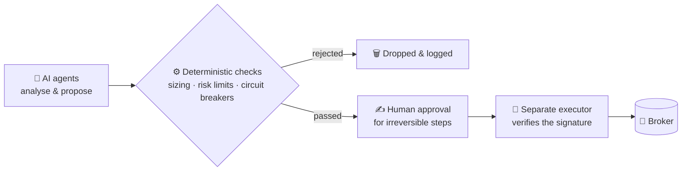

# Hi, I'm Chonz 👋

I build trading and portfolio infrastructure for US equities and crypto. AI agents write much of the code; I design the rules, checks and guards they work under, and I own what ships.

8+ years as a full-stack engineer, then Web3 / DeFi, now systems where a bug can move real money.

  

## 🛠️ What I'm building now

- **Signed order execution** — An order a person approves on their phone is verified against a hand-carried public key on a separate machine before it reaches the broker. Fully compromising the web side can withhold an approval, but cannot forge one.
- **Portfolio monitoring for US equities** — Live broker data and end-of-day reports merged into one read-only portfolio view. My largest system: 1,500+ commits.
- **Multi-agent trade advisory** — Technical, sentiment, bull/bear debate and risk-review agents produce structured proposals. Position sizing, risk limits and circuit breakers live in deterministic code, never in the model.
- **Research and data pipeline** — A market data lake (daily prices, corporate actions, security master) feeding an AI research assistant for daily digests and company deep dives.

## 🧭 The pattern I build around

## 🤝 How I work with AI

- **Every rule has a failure behind it.** If something can be enforced by a hook, a test or a gate, it is not written as a reminder.
- **Agents propose; code and people decide.** Live-order paths, remote writes and irreversible actions always stop for a human.
- **Numbers are checked by code, not by the model.** Where a model writes a report, figures are filled in and verified by code against the source data.

My day-to-day setup (rules, skills and safety guards for Claude Code, Codex and Pi) is public: **[agent-harness](https://github.com/Chonz-dot/agent-harness)**.

## 📜 Earlier

DeFi lending protocol and dApp front ends, on-chain analytics, exchange market-making tools and real-time monitors. Public examples: [hyper-unstaking-monitor](https://github.com/Chonz-dot/hyper-unstaking-monitor) (real-time HYPE unlock and wallet alerts on Hyperliquid) and [hummingbot-strategies](https://github.com/Chonz-dot/hummingbot-strategies) (classic crypto strategies as Hummingbot scripts).
